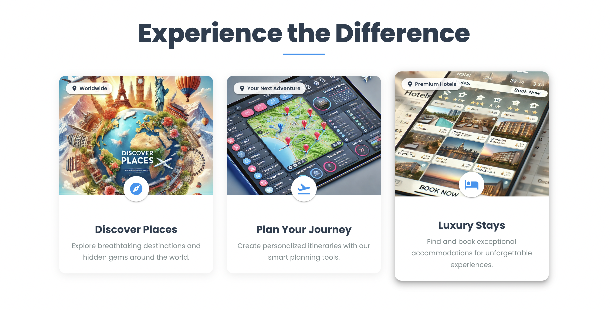
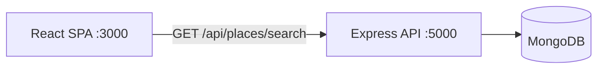

<div align="center">

# WanderlistAi

A travel-planning web app prototype with a React and Material UI frontend and an Express and MongoDB API.


</div>

> **Status: early prototype.** The UI and routing are in place. Destination search returns a placeholder result, and the trips and profile pages show sample data.

## Overview

WanderlistAi is the start of a trip planner: search for a destination, keep a list of trips and manage a traveler profile. The frontend is a Create React App single-page app with an animated landing page. The backend is an Express server that connects to MongoDB and exposes a places search endpoint, which is ready to be wired to a real places API.

## Features

- **Landing page**: Hero section and animated feature cards for Discover Places, Plan Your Journey and Luxury Stays, built with Framer Motion.
- **Destination search**: A search field that calls `GET /api/places/search?query=` and lists the results.
- **My Trips**: Trip cards with destination, dates and status (Upcoming, Planning, Completed). The trips are sample data.
- **Profile**: Traveler profile with an about section and travel stats. This is also sample data.
- **Navigation**: Responsive MUI navbar with React Router routes `/`, `/search`, `/itinerary` and `/profile`.

## Screenshots

<p align="center">
  
</p>
<p align="center">
  
</p>

## Tech stack

| Layer | Technology |
|-------|------------|
| Frontend | React 18 (Create React App), React Router 6, Material UI 5, Framer Motion, axios |
| Backend | Node.js, Express 4, CORS, dotenv |
| Database | MongoDB with Mongoose 8 |

`jsonwebtoken` and `bcryptjs` are listed as backend dependencies for planned authentication, but the code does not use them yet.

## Architecture



## Project structure

```
WanderlistAi/
├── backend/
│   ├── server.js            # Express app, Mongoose connection, route mounting
│   ├── routes/places.js     # GET /api/places/search (placeholder data)
│   └── .env.example
└── frontend/
    ├── public/
    └── src/
        ├── App.js           # Router
        ├── components/Navbar.js
        ├── pages/           # Home, Search, Itinerary, Profile
        └── assets/images/   # Hero and feature images, screenshots
```

## Getting started

### Prerequisites

- Node.js 18+
- A MongoDB instance (local or Atlas)

### Backend

```bash
git clone https://github.com/abhiishek340/WanderlistAi.git
cd WanderlistAi/backend
npm install
cp .env.example .env     # then fill in your values
npm start                # or: npm run dev (needs nodemon)
```

| Variable | Description |
|----------|-------------|
| `PORT` | Port for the Express API (defaults to `5000`) |
| `MONGODB_URI` | MongoDB connection string |

### Frontend

```bash
cd WanderlistAi/frontend
npm install
npm start                # http://localhost:3000
```

### API

| Method | Path | Description |
|--------|------|-------------|
| `GET` | `/api/places/search?query=` | Returns a placeholder list of places |

## Limitations

- `server.js` mounts `./routes/users`, which is not in the repo. Create that router or remove the line before starting the backend.
- `routes/places.js` imports `axios`, which is not in the backend `package.json`. Install it with `npm install axios`.
- The frontend calls `/api/...` with relative URLs and has no `proxy` setting. Add `"proxy": "http://localhost:5000"` to `frontend/package.json` in development.
- `Itinerary.js` and `Profile.js` import from Material-UI v4 (`@material-ui/core`, including `makeStyles`), which is not installed. Port them to MUI v5 (`@mui/material` with `styled` or `sx`) to match the rest of the app.

---

Built by [Abhishek Yadav](https://github.com/abhiishek340)
